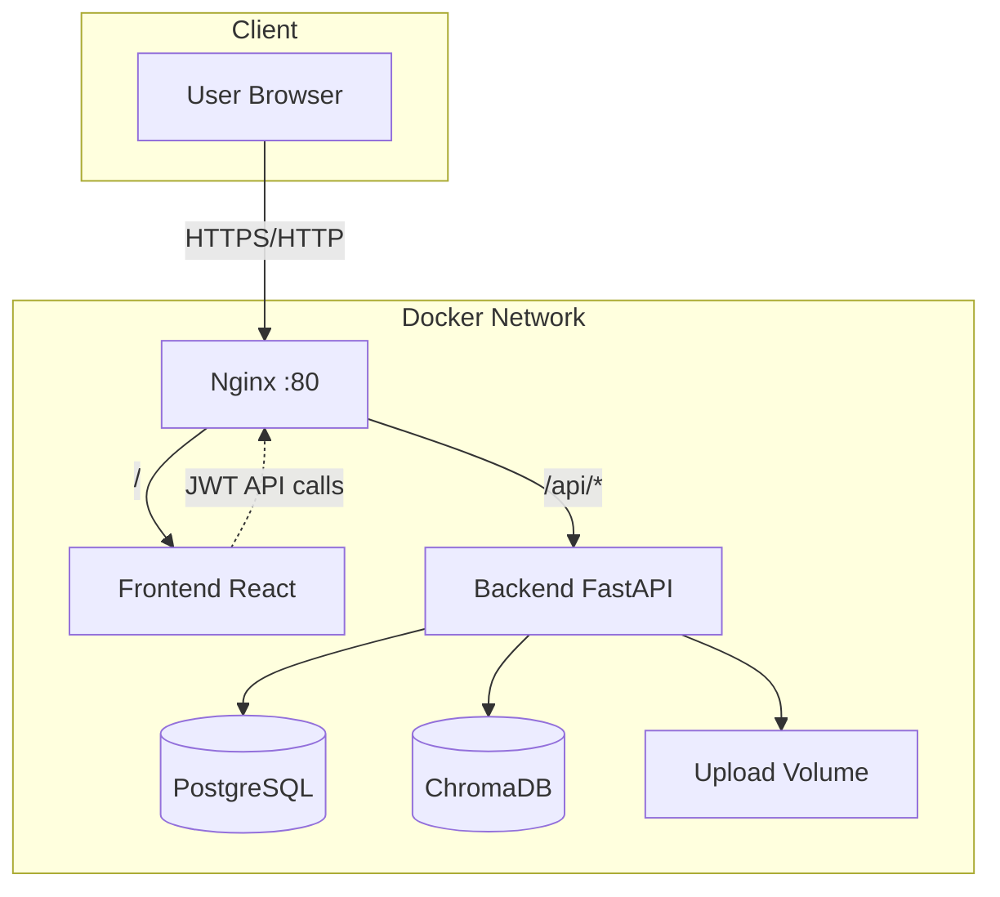
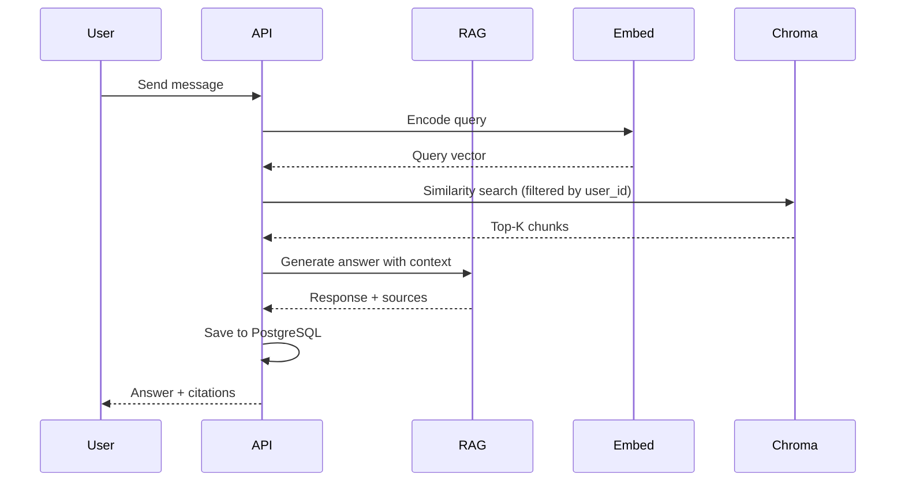

# System Architecture

## Overview

AI Chatbot Cloud is a multi-tier, containerized application designed for deployment on Ubuntu Linux cloud VMs (AWS EC2, Google Compute Engine, etc.).

## Component Diagram



## Clean Architecture (Backend)

```
┌─────────────────────────────────────────────┐
│  API Layer (routes, schemas, dependencies)  │
├─────────────────────────────────────────────┤
│  Application Layer (services / use cases)     │
├─────────────────────────────────────────────┤
│  Domain Layer (entities)                    │
├─────────────────────────────────────────────┤
│  Infrastructure (DB, Chroma, embeddings)      │
└─────────────────────────────────────────────┘
```

### Layer Responsibilities

| Layer | Responsibility |
|-------|----------------|
| **API** | HTTP handling, validation, auth middleware |
| **Application** | Auth, chat, document processing, RAG orchestration |
| **Domain** | Pure business entities (User, Conversation, Message) |
| **Infrastructure** | SQLAlchemy models, repositories, ChromaDB, Sentence Transformers |

## RAG Pipeline



## Data Flow: Document Upload

1. User uploads PDF/TXT via frontend
2. Backend saves file to volume (`/app/uploads`)
3. Text extracted (PyPDF / UTF-8)
4. LangChain `RecursiveCharacterTextSplitter` chunks text
5. Sentence Transformers generates embeddings
6. Vectors stored in ChromaDB with `user_id` metadata
7. Document metadata saved in PostgreSQL

## Multi-Tenancy

Each user's vectors are isolated using ChromaDB metadata filter `user_id`. Users cannot retrieve another user's documents.

## Scalability Notes

- **Horizontal**: Run multiple backend replicas behind Nginx load balancer
- **ChromaDB**: Can migrate to managed vector DB or Chroma cluster
- **Embeddings**: Consider dedicated GPU worker for high throughput
- **PostgreSQL**: Use RDS/Cloud SQL for managed HA

## Monitoring

- Application logs: stdout (Docker logs)
- Health: `GET /health` (backend), Nginx `/health`
- Metrics: Prometheus format at `/api/monitoring/metrics`
- Dashboard: `/monitoring` in frontend UI
