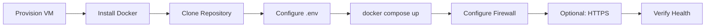

# Cloud Deployment Guide

Step-by-step deployment workflow for AWS EC2 or Google Cloud Compute.

## Prerequisites

- Ubuntu 22.04 LTS VM (minimum: 2 vCPU, 4 GB RAM, 20 GB disk)
- Domain name (optional, for HTTPS)
- Docker & Docker Compose installed ([linux-server-setup.md](linux-server-setup.md))

## Deployment Workflow



## Step 1: Provision Cloud VM

### AWS EC2

1. Launch instance: Ubuntu 22.04, `t3.medium` or larger (embedding model needs RAM)
2. Security Group: allow SSH (22), HTTP (80), HTTPS (443)
3. Attach Elastic IP (recommended)
4. Connect: `ssh -i key.pem ubuntu@<elastic-ip>`

### Google Cloud

1. Create Compute Engine VM: `e2-medium`, Ubuntu 22.04
2. Firewall: `default-allow-http`, `default-allow-https`
3. Connect: `gcloud compute ssh <instance-name>`

## Step 2: Server Preparation

```bash
# Run setup script (as root or with sudo)
sudo bash scripts/setup-server.sh
```

Or follow [linux-server-setup.md](linux-server-setup.md) manually.

## Step 3: Deploy Application

```bash
# Clone project
git clone <your-repo-url> /opt/ai-chatbot
cd /opt/ai-chatbot

# Configure environment
cp .env.example .env
nano .env   # Set SECRET_KEY, POSTGRES_PASSWORD, CORS_ORIGINS

# Build and start
docker compose up -d --build

# Check status
docker compose ps
docker compose logs -f backend
```

## Step 4: Verify Deployment

```bash
curl http://localhost/health
curl http://localhost/api/health
```

Open browser: `http://<server-ip>/`

## Step 5: HTTPS with Let's Encrypt (Recommended)

Install Certbot on host and proxy certificates to Nginx, or use a companion `docker-compose` override:

```bash
# Example: certbot standalone (stop nginx briefly)
sudo certbot certonly --standalone -d yourdomain.com
```

Mount certificates in `nginx/conf.d/ssl.conf` and listen on 443.

## Step 6: CI/CD (GitHub Actions)

On push to `main`:

1. **CI** runs lint/build tests
2. **Deploy** (manual or SSH) pulls latest and runs `docker compose up -d --build`

Configure GitHub secrets:

| Secret | Description |
|--------|-------------|
| `DEPLOY_HOST` | Server IP or hostname |
| `DEPLOY_USER` | SSH user (e.g. `ubuntu`) |
| `DEPLOY_KEY` | Private SSH key |
| `DEPLOY_PATH` | `/opt/ai-chatbot` |

## Environment Variables (Production)

```env
APP_ENV=production
DEBUG=false
SECRET_KEY=<64-char-random-string>
POSTGRES_PASSWORD=<strong-password>
CORS_ORIGINS=https://yourdomain.com
```

## Rollback

```bash
cd /opt/ai-chatbot
git checkout <previous-tag>
docker compose up -d --build
```

## Troubleshooting

| Issue | Solution |
|-------|----------|
| Backend unhealthy | Check `docker compose logs backend` — model download on first start |
| Chroma connection failed | Ensure `chromadb` container is healthy |
| 502 Bad Gateway | Backend still starting; wait 2–3 min for embedding model |
| Upload fails | Check `client_max_body_size` in Nginx (default 15M) |

## Backup

```bash
# PostgreSQL
docker exec chatbot-postgres pg_dump -U chatbot chatbot_db > backup.sql

# Chroma + uploads
docker run --rm -v ai-chatbot_chroma_data:/data -v $(pwd):/backup alpine tar czf /backup/chroma.tar.gz /data
```
